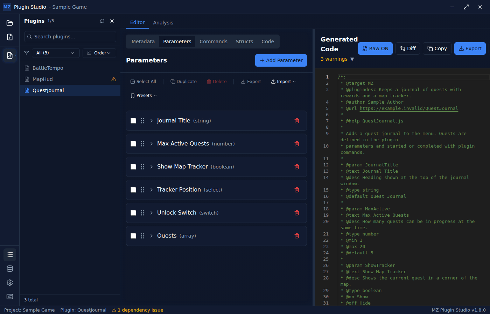
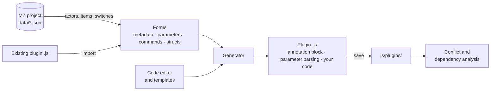
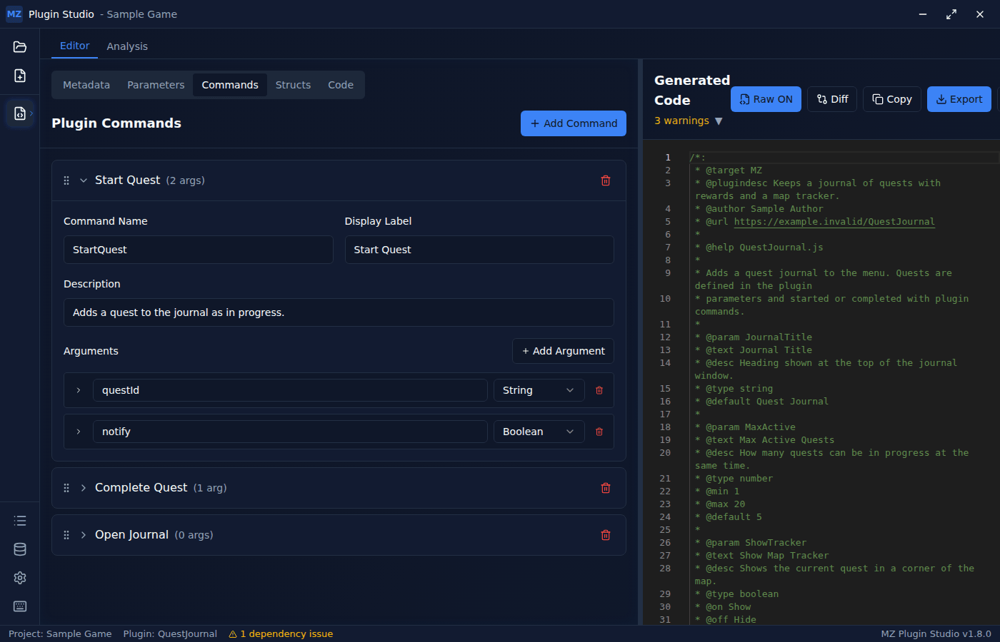
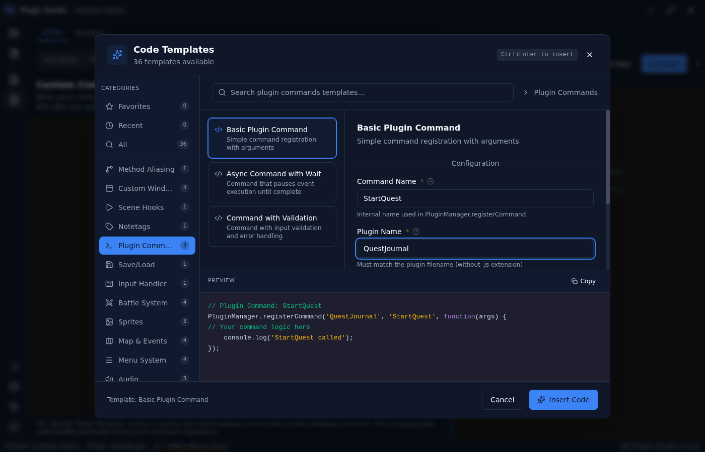
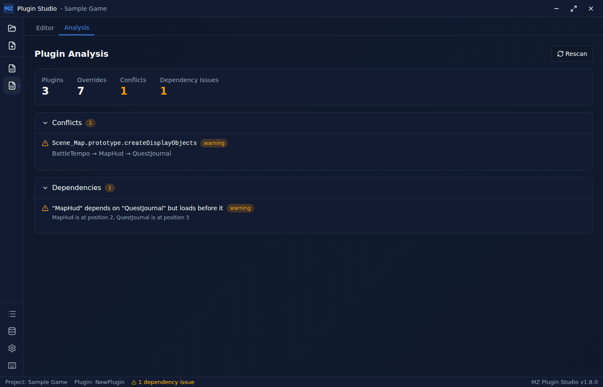
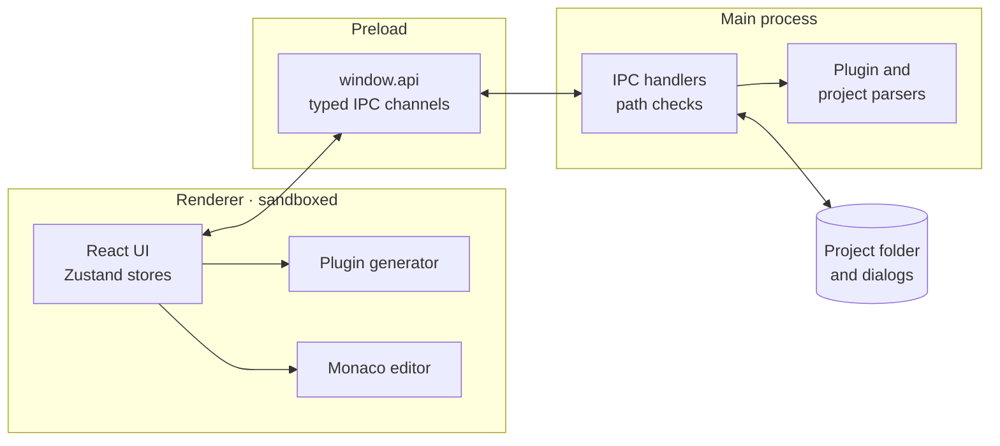

# MZ Plugin Studio

A desktop editor for RPG Maker MZ plugins.

You define parameters, commands and structs in forms; it writes the annotation block and the code that
parses them, and you add the plugin's behaviour in its code editor or from templates. It also loads your
MZ project, so game-data parameters pick from your actual actors, items and switches.

[](https://github.com/Wintersta7e/mz-plugin-studio/actions/workflows/ci.yml)
[](https://github.com/Wintersta7e/mz-plugin-studio/releases/latest)
[](https://github.com/Wintersta7e/mz-plugin-studio/releases/latest)


[](https://prettier.io/)
[](./LICENSE)




---

## Why

An MZ plugin describes its settings in a comment block at the top of the file — `@param`, `@type`,
`@default`, `@parent`, `@option` and the rest — and RPG Maker's Plugin Manager builds its settings
screen from that block. What reaches the plugin at runtime is all strings: numbers arrive as text, a
struct arrives as JSON, and an array of structs arrives as JSON whose elements are JSON again. Every
plugin repeats the same two chores: writing the annotation block by hand, and writing the code that
turns those strings back into values.

MZ Plugin Studio does both from one definition. The annotation block and the parsing code are
generated together, so a parameter's declared type and the code that reads it stay in step.



## Status

A personal tool, maintained. It runs on Windows as a portable executable. The current work is
upkeep — tests, CI, dependency updates and security fixes — rather than new features.

**Known limits:**

- **Raw mode** keeps an imported plugin's own file text when it saves; the
  [User Guide](./docs/USER_GUIDE.md#raw-mode) says what a save changes. Its limits:
  - Files are read as UTF-8 only: a plugin or `.mzparams` file in another encoding is refused
    when you open it or import parameters from it.
  - Header edits are refused for a file without a `/*:` or `/*:en` annotation block.
  - Added parameters, commands or structs are refused for a file that is not valid JavaScript,
    and any save whose result would not be valid JavaScript is refused.
  - Language blocks (`/*:ja` and others) are never updated, so a parameter or command added in
    raw mode is missing from them and the editor in that language does not show it.
  - **Save All** skips an imported plugin with raw mode off until a **Ctrl+S** save of it is
    confirmed.
- **Upgrading from 1.7.x** ([details](./docs/USER_GUIDE.md#loading-a-project)): the app now keeps
  its own record of the project folders you chose with **Open Project**, so the first time you open
  each project from the recent projects list it asks whether to open that folder. Choose **Open** if
  it is your project; after that it opens straight away.
- **Upgrading from 1.6.x** ([details](./docs/USER_GUIDE.md#upgrading-from-16x)):
  - Imported plugin tabs opened in 1.6.x have no file text, and raw mode refuses to save them
    until you open the project and click **Reload** in the notice that names them, or
    **Reload from project** in each such tab.
  - Plugin tabs saved in 1.6.x cannot confirm their file is unchanged: **Save All** leaves them
    unsaved until one **Ctrl+S** of each, whose prompt asks before replacing the file.
- The app does not update itself: new versions are on the
  [Releases](https://github.com/Wintersta7e/mz-plugin-studio/releases) page.

## Features

### Plugin building

- **Metadata editor** — name, version, author, description, help text, URL
- **Parameter builder** — every supported parameter type, with a grouped type dropdown, progressive
  disclosure, drag-and-drop reordering, inline validation, bulk operations and presets
- **Command builder** — plugin commands with typed arguments
- **Struct definitions** — nested data structures, with a visual editor for struct defaults
- **Multi-language** — Japanese (ja) and Chinese (zh) localization tabs



### Parameter Types

| Category      | Types                                                                                                                                  |
| ------------- | -------------------------------------------------------------------------------------------------------------------------------------- |
| **Basic**     | string, number, boolean, select, combo, note, text, hidden                                                                             |
| **Game Data** | variable, switch, actor, class, skill, item, weapon, armor, enemy, troop, state, animation, tileset, common_event, map, location, icon |
| **Advanced**  | file, struct, array, color                                                                                                             |

Attributes: `@text`, `@desc`, `@default`, `@min` / `@max`, `@decimals`, `@dir`, `@parent`, `@on` /
`@off`, `@option` / `@value`.

### Code Template Library

Templates insert working code for common plugin patterns, grouped by category:

| Category            | Covers                               |
| ------------------- | ------------------------------------ |
| **Method Aliasing** | Extend existing MZ classes safely    |
| **Custom Windows**  | Windows, HUDs, popups, gauges        |
| **Scene Hooks**     | Hook into scene lifecycle            |
| **Notetags**        | Add note tag parsing                 |
| **Plugin Commands** | Basic, async, and validated commands |
| **Save/Load**       | Persistent data storage              |
| **Input Handler**   | Keyboard and gamepad input           |
| **Battle System**   | Actions, damage, turn hooks          |
| **Sprites**         | Custom sprites and animations        |
| **Map & Events**    | Event spawning, movement, transfers  |
| **Menu System**     | Custom scenes, title mods, options   |
| **Audio**           | BGM control, SFX, crossfades         |
| **Messages**        | Text codes, window mods, choices     |
| **Actor & Party**   | Custom properties, party management  |



### Code editor

- **Monaco editor** with JavaScript highlighting and MZ class completions
- **Works offline** — the editor ships inside the app; nothing is downloaded at startup
- **Live preview** — the generated plugin updates as you edit
- **Diff view** — generated output side by side with the saved file
- **Validation** — unused structs, orphaned parent references, unimplemented commands, invalid struct
  default JSON
- **Export** — `.js`, README.md, `.d.ts` type declarations, or a `plugins.json` entry

### Project integration

- **Load an MZ project** — database entries (actors, classes, skills, items, weapons, armors, enemies,
  troops, states, animations, tilesets, common events, switches, variables) fill the game-data dropdowns
- **Import existing plugins** — parse and edit `.js` plugins already in `js/plugins/`
- **Save into the project** — write straight to `js/plugins/`
- **Plugin browser** (Ctrl+Shift+E) — a searchable side panel of every plugin in `js/plugins/`, with
  Open / Dirty / Errors filters and per-row status, built for projects with many plugins
- **Conflict detection** — flags methods that two or more plugins override, ranked by how widely the
  class is used
- **Dependency analysis** — reads `@base`, `@orderAfter` and `@orderBefore` across the project and
  reports missing and circular dependencies and load-order violations



### Also

- Auto-generated help text from plugin metadata
- `@noteParam` groups for RPG Maker's deployment packager
- Dark and light themes, synced to the editor
- Keyboard shortcuts (F1 lists them)
- ARIA labels and live regions across the sidebar, status bar and toasts
- Structured logging to file, with a debug toggle in Settings

## Quick start

**Use it:** download `mz-plugin-studio-<version>-portable.exe` from the
[latest release](https://github.com/Wintersta7e/mz-plugin-studio/releases/latest) and run it — there is
no installer.

**Build it:**

```bash
git clone https://github.com/Wintersta7e/mz-plugin-studio.git && cd mz-plugin-studio
npm install            # on a WSL /mnt/ path: npm install --no-bin-links
npm run dev            # start with hot reload
```

Node.js — the version in `package.json` `engines`.

Then: **+** in the sidebar creates a plugin; fill in the Meta tab, add parameters and commands, insert
templates from the code editor, and save into your project's `js/plugins/` folder. The
[User Guide](./docs/USER_GUIDE.md) walks through every screen.

## Development

```bash
npm run check          # every gate of the tree, listed below; not the e2e suite
npm run check:commits  # the commits since origin/main: golden-output and commit-message rules, as CI runs them
npm run typecheck      # tsc for main, renderer, tests, tools, scripts and e2e
npm run lint           # ESLint
npm run format         # Prettier
npm test               # Vitest
npm run test:golden    # generated-plugin output against the golden corpus
npm run build:win      # portable Windows build into dist/
```

`npm run check` runs, in order: `ci:runtime-deps`, `lint`, `typecheck`, `typecov:report`, `deps`,
`knip:report`, `jscpd:report`, `format:check`, `strictness:status`, `licenses`, `test:coverage` and
`test:golden:coverage`. Lint findings, pending type-check errors, unused exports and duplicated code
each hold an exact ceiling that fails when the count rises or falls, so a change that lowers a count
lowers its ceiling in the same commit. The ceilings live in `eslint-suppressions.json`,
`pending-ceilings.json` and the `knip:production` and `jscpd:report` scripts in `package.json`.

The end-to-end suite drives the packaged app, and CI requires it:

```bash
npm run e2e:prepare        # rebuild the unpacked release in dist/ that the suite drives
npm run e2e                # Playwright flows and release smoke on that build
npm run e2e:visual:update  # remake the visual baselines in the pinned image (Docker, Linux host)
```

- `npm run e2e:prepare` always rebuilds. `npm run e2e:prepare -- --reuse` keeps an unpacked release built earlier in the same job, as the Windows CI jobs do, and builds one if none is there.
- On Linux, `npm run e2e` needs a display: `xvfb-run -a -s "-screen 0 1920x1080x24" npm run e2e`.
- The baselines are pixel-exact only in the pinned image, so the visual project exists only where `E2E_VISUAL_IMAGE=1`, which the update script and CI set inside it. On any other host `npm run e2e:visual` stops and names the command to use instead: `npm run e2e:visual:update -- --check` compares the screenshots with the baselines and writes nothing. That script is the only place baselines are made.

A test run fails when any test is skipped, left as a todo or marked to pass by failing. The one allowed skip is the check that the suite's plugin loader stand-in behaves like RPG Maker MZ's own core scripts: it needs a local RPG Maker MZ install, so it runs only when `MZ_CORESCRIPT_DIR` names the install's folder that holds `rmmz_managers.js` and the other core scripts. Run it after changing `tests/helpers/mz-runtime.ts`, `tests/helpers/mz-conformance.ts` or generated output:

```bash
MZ_CORESCRIPT_DIR=<core-scripts-folder> npm run test:parity
```

Without the variable, `npm run test:parity` reports both tests skipped. It was last compared against core scripts v1.10.0 (the `rmmz_managers.js` header line), with no plugin behaving differently.

## Architecture

The renderer is sandboxed and reaches files only through the preload bridge; every main-process
handler checks the paths it is given.



`src/shared/` holds the types, IPC channel names and path checks both sides use.

```
mz-plugin-studio/
├── src/
│   ├── main/       # Electron main process: windows, file access, MZ project parsing
│   ├── preload/    # the typed bridge between main and renderer
│   ├── renderer/   # React app: editors, preview, analysis, plugin generator
│   └── shared/     # types and checks used on both sides
├── tests/          # Vitest suites and their fixtures
├── e2e/            # Playwright flows, release smoke and visual tests on the packaged app
├── scripts/        # repository checks, run by CI and through npm scripts
├── tools/          # scripts that enrich the MZ class dictionary used by autocomplete
├── docs/           # user guide and template contribution guide
└── resources/      # app icons
```

## Stack

| Layer  | Choice                          | Notes                                                                                                                                                                                |
| ------ | ------------------------------- | ------------------------------------------------------------------------------------------------------------------------------------------------------------------------------------ |
| Shell  | Electron                        | Sandboxed, context-isolated renderer; IPC handlers validate file paths                                                                                                               |
| UI     | React, Tailwind CSS, Radix UI   | shadcn/ui-style components                                                                                                                                                           |
| State  | Zustand                         | Persisted stores                                                                                                                                                                     |
| Editor | Monaco                          | MZ class completions from a bundled dictionary                                                                                                                                       |
| Build  | electron-vite, electron-builder | Portable Windows target                                                                                                                                                              |
| Tests  | Vitest, Playwright              | Unit (`tests/unit/`), integration (`tests/integration/`), DOM and component (`tests/dom/`) and golden-output (`tests/golden/`) suites; end-to-end flows on the packaged app (`e2e/`) |

## Documentation

- [User Guide](./docs/USER_GUIDE.md) — every screen, parameter type and template
- [Contributing templates](./docs/CONTRIBUTING_TEMPLATES.md) — how to add a code template
- [Changelog](./CHANGELOG.md)

## Security

Report security problems privately — see [SECURITY.md](./SECURITY.md). Versions before 1.6.1 could
write field text into a generated plugin as code
([advisory](https://github.com/Wintersta7e/mz-plugin-studio/security/advisories/GHSA-436j-76q4-whg2));
use the latest release.

## Contributing

Issues are welcome. For anything larger than a small fix, open an issue before a pull request. Before submitting, run `npm run check` and `npm run check:commits`. Each commit's subject is at most 72 characters, and its message carries no trailer (`Signed-off-by:`, `Co-authored-by:` and the like) but `Co-Authored-By: Rooty` or `Co-Authored-By: Leafy`.

## License

[MIT](./LICENSE). Third-party dependency licenses are listed in
[THIRD_PARTY_LICENSES.md](./THIRD_PARTY_LICENSES.md).

'RPG Maker' and 'RPG Maker MZ' are trademarks of their respective owners. MZ Plugin Studio is an
independent tool, not affiliated with or endorsed by them.

---

Related: `mz-interaction-builder` (dialogue trees) · `mz-scene-builder` (cutscene timelines).
